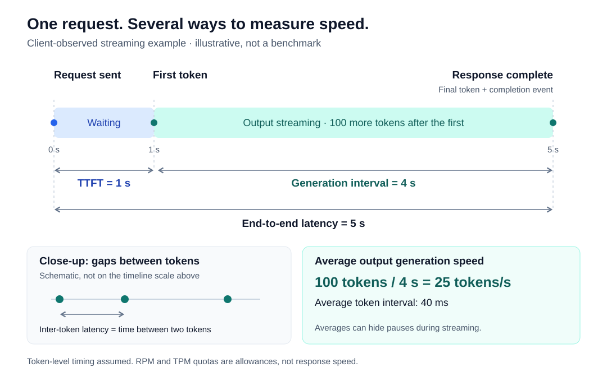

# Model API Metrics: Traffic, Limits, and Latency

This is a conceptual primer, not a provider specification. Measurement conventions vary across tools. Numeric examples are illustrative, not benchmark results.

## 1. Problem: what does "fast" mean?

A model API advertises a large token quota. Another starts streaming quickly. A third finishes long responses sooner.

Which is faster?

They describe different things: **how much traffic is allowed, how soon output starts, and how soon it finishes.** No single number answers all three.

This article explains the vocabulary. The [evaluation guide](evaluating-model-apis.md) explains how to use it to choose an API.

## 2. Tokens are units of model input and output

A token is a unit of text, such as a word, part of a word, or punctuation. Different models can split the same text into different tokens.

| Term | Simple meaning |
| --- | --- |
| Input tokens | Content sent to the model. |
| Output tokens | Content generated by the model. |
| Context window | How much content a model can handle in one request, not per minute. |

APIs may account for cached input, reasoning, and multimodal content differently. Visible text alone may not explain all usage or cost.

## 3. Traffic, allowances, and concurrency

| Metric | Meaning | PM interpretation |
| --- | --- | --- |
| RPM: requests per minute | Requests counted during a minute, or a request-rate allowance. | How much request traffic is arriving, or permitted? |
| TPM: tokens per minute | Tokens counted during a minute, or a token-rate allowance. | How much token traffic is arriving, or permitted? |
| Concurrency | Requests in flight at the same time. | How many requests occupy the service simultaneously? |
| Throughput | Work completed per unit of time, such as completed requests per second or output tokens per second. | How much useful work can the service deliver? |

**Do not confuse:**

- **Observed traffic and quota:** 100 observed RPM is actual traffic; a 100 RPM limit is an allowance.
- **TPM and response speed:** a 100,000 TPM quota does not mean one response generates at that speed.
- **RPM and concurrency:** longer requests can fill concurrency slots even when RPM is low.
- **Counting rules:** state whether TPM counts input, output, or both, and whether RPM includes failed attempts.

For enforcement scopes and shared quotas, see [rate-limit design](rate-limit-scopes.md).

## 4. Response speed has several parts

| Metric | Meaning | PM interpretation |
| --- | --- | --- |
| TTFT: time to first token | Elapsed time from a defined request start to the first output token. | How long does the user wait before output begins? |
| Inter-token latency | Time between successive output tokens. | Does output arrive smoothly or pause? |
| Output generation rate | Output tokens divided by a defined generation interval. | How quickly does output arrive once generation starts? |
| End-to-end latency | Elapsed time from request start to response completion. | How long until the complete result is available? |

**Watch out for:**

- **Headers or empty streaming events:** they are not output tokens. For user experience, also measure time to first visible content.
- **Average generation speed:** a good average can hide pauses between tokens.
- **Streaming chunks:** one chunk can contain several tokens. Chunk timing is not exact token timing.

### An illustrative request timeline

Suppose a client sends a request at 0 seconds, receives the first token at 1 second, and receives the final token and completion event at 5 seconds. There are 100 more tokens after the first.

| Measurement | Result |
| --- | --- |
| Client-observed TTFT | 1 second. |
| Client-observed end-to-end latency | 5 seconds. |
| Average time per subsequent output token | 4 seconds divided by 100 intervals: 40 milliseconds. |
| Average subsequent-token rate | 100 tokens over 4 seconds: 25 tokens per second. |

This assumes token-level timing is available. It describes one request, not typical API performance.

## 5. Name the measurement boundary

| Measurement point | What it can include |
| --- | --- |
| Client | Network time, service time, and client processing. |
| Gateway | Gateway handling and the upstream round trip. |
| Inference server | Its own queue and model execution. |

Label the measurement point and define the start and end events. Compare like with like.

Non-streaming responses do not directly expose client-observed TTFT. For multi-step workflows, measure the whole task as well as individual API calls.

## 6. Look beyond averages

| Measure | What it tells you | Main caution |
| --- | --- | --- |
| Average latency | Mean waiting time. | Can hide a slow minority. |
| p50 latency | About half of observations are at or below this value. | Does not describe the slower users. |
| p95 latency | About 95% of observations are at or below this value. | A tiny sample gives weak evidence. |
| Failures and timeouts | Requests that did not complete successfully. | Excluding them can make latency look better. |
| Aggregate throughput | Total work delivered across requests per unit of time. | Not the streaming speed of one response. |

Report sample size, request sizes, test duration, and traffic level. State what was counted, including failures, and compare similar workloads.

## 7. PM questions

1. **What does the user wait for?** First visible output, a complete structured result, or a finished multi-step task?
2. **Which workload are we measuring?** Record input and output lengths, streaming mode, and expected concurrency.
3. **Is this an allowance or an observation?** Keep quota, achieved throughput, and latency separate.
4. **Where does the clock start and stop?** Compare matching boundaries and include failures.

**Reusable lesson:** a metric becomes useful only when its unit, counting rules, measurement boundary, and workload are clear.

[Next: evaluating a model API](evaluating-model-apis.md) | [Back to the AI gateway module](README.md)
